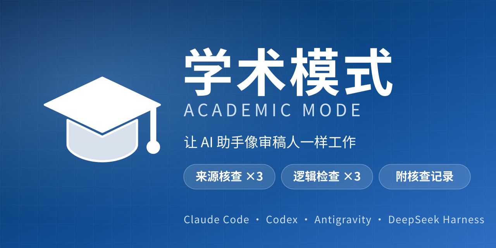

<p align="center">
  
</p>

<p align="center">
  <a href="https://github.com/FelixJiashengFu/dsh-academic-switch/actions/workflows/test.yml"></a>
  <a href="https://github.com/FelixJiashengFu/dsh-academic-switch/releases/latest"></a>
  <a href="https://www.npmjs.com/package/dsh-academic-switch"></a>
  <a href="LICENSE"></a>
</p>

<p align="center"><a href="README.md">中文</a> · <b>English</b></p>

# Academic Mode

**Make your AI assistant work like a peer reviewer.** It gives the AI a verification discipline it has to follow: every cited source is checked three times, every deliverable gets three logic reviews, and the answer ends with a log of what was checked and how.

For **Claude Code · Codex · Antigravity · DeepSeek Harness**.

## Why

When an AI writes a paper or a literature review, the dangerous failure is not bad writing. It is writing that looks right:

- a cited paper that does not exist, or a DOI, volume or page range that does not match;
- a real quotation whose claim was quietly strengthened, "may be associated with" turned into "proves";
- numbers nobody recomputed, percentages mixed up with percentage points;
- no sign anywhere of which step was skipped.

Academic Mode does not make the model smarter. It turns verification into a **required step**, and makes whatever was skipped **visible** in the deliverable.

## What it makes the AI do

| Step | What | What it catches |
| --- | --- | --- |
| **Three-pass source check** | Pass 1: the source exists and its metadata matches. Pass 2: go back to the text and check numbers and quotes. Pass 3: cross-check with an independent source and look for retractions | Invented papers, misquoted numbers, retracted studies |
| **Three-pass logic review** | Pass 1: the argument's structure. Pass 2: common fallacies, and recompute the numbers. Pass 3: argue against itself as a reviewer would | Broken reasoning chains, wrong statistics, conclusions that do not survive a challenge |
| **Multi-angle research** | Chinese and English search terms; at least three kinds of source; evidence for and against; trace claims to the original | One-sided evidence, reliance on second-hand summaries |
| **Pre-delivery checklist** | Ten items, with the result written into the log | Quietly skipped steps |
| **Verification log** | Attached to the answer; every line maps to a page that was actually opened or a command that was actually run | Conclusions you cannot trace |

The three passes use three different methods rather than repeating one check three times: each method catches errors the other two cannot.

## What a deliverable looks like

This is a **format example** of a verification log. The content comes from a real check made while building this project and was written up by hand. It is not model output.

> **Question**: Which edition of GB/T 7714 (China's reference-list standard) is current?
>
> **Conclusion** (confidence: medium): GB/T 7714—2025 is current. Published 2025-12-02, in force from 2026-07-01, it replaces the 2015 edition.
>
> ### Verification log
>
> | Source | Pass 1 | Pass 2 | Pass 3 | Verdict |
> | --- | --- | --- | --- | --- |
> | ① Official standards platform | Entry exists, status "current" | Both dates match the conclusion | Official primary source | Used |
> | ② readwonders.com guide | Page exists; secondary | Dates match ① | Says it relies on ①, so not independent | Corroboration only |
>
> **Source notes**: ① std.samr.gov.cn (National Public Service Platform for Standards Information), query result opened 2026-11-01: GB/T 7714-2025 "Information and documentation: rules for bibliographic references", recommended standard, issued 2025-12-02, in force 2026-07-01, status "current"; GB/T 7714-2015 is marked "abolished". ② The page's own source list names ① as its basis.
>
> **Search terms**: GB/T 7714 2025; reference rules current edition; effective date.
>
> **Limits**: only one independent primary source (the official platform), so confidence is "medium", not "high"; the text of the standard itself was not read.
>
> **Self-check**: 10/10 passed (item 3 marked "single source").

Look at the last two lines. It does not pretend to have checked everything. It says there is one independent source and that the standard's text was not read, and it lowers its confidence accordingly. That is the behaviour this discipline is after.

## Install in 30 seconds

| Your tool | Install |
| --- | --- |
| **Claude Code** | `/plugin marketplace add FelixJiashengFu/dsh-academic-switch`<br>`/plugin install academic-mode@felixfu-plugins` |
| **Codex** | `codex plugin marketplace add FelixJiashengFu/dsh-academic-switch`<br>`codex plugin add academic-mode@felixfu-plugins` |
| **Antigravity** | Copy one agent file, see [below](#antigravity), then pick it under "Main Agent" |
| **DeepSeek Harness** | In the plugin page enter `dsh-academic-switch` or this repository's URL, install, then enable |
| **Any other tool that reads SKILL.md** | `npx skills add FelixJiashengFu/dsh-academic-switch --skill academic-mode` |

Then try:

- `Use academic mode to check whether this reference really exists: ...`
- `Use academic mode to review the last two years of work on X, with a verification log`
- `Use academic mode to find the logical gaps in this argument`

<details>
<summary><b>More on Claude Code</b></summary>

From a terminal, `claude plugin marketplace add …` and `claude plugin install …` work the same way. Claude Code 2.1.275 or later can also do it in one step:

```
/plugin install academic-mode --marketplace FelixJiashengFu/dsh-academic-switch
```

Restart the session or run `/reload-plugins` afterwards. Invoke it with `/academic-mode:academic-mode`, or just say "use academic mode".

</details>

<details>
<summary><b>More on Codex</b></summary>

It takes effect in a new session. Type `$` or run `/skills` to pick it manually. If you only want the skill and not the plugin, copy the folder `plugins/academic-mode/skills/academic-mode` into `~/.agents/skills/`.

</details>

<h3 id="antigravity">Antigravity</h3>

There are two ways in. A **custom agent** is closer to a "mode": once you pick it, the whole conversation follows the discipline, instead of depending on the model deciding to load a skill. It shows up in the "Main Agent" dropdown under the input box and in the Custom Agents section of the Customizations page.

The agent is one Markdown file, [`antigravity/agents/academic-mode.md`](antigravity/agents/academic-mode.md). The `skills` tool installs skills, not agents, so you copy the file.

PowerShell, as a global agent (all projects):

```
New-Item -ItemType Directory -Force "$HOME\.gemini\config\agents" | Out-Null
Invoke-WebRequest https://raw.githubusercontent.com/FelixJiashengFu/dsh-academic-switch/main/antigravity/agents/academic-mode.md -OutFile "$HOME\.gemini\config\agents\academic-mode.md"
```

macOS / Linux:

```
mkdir -p ~/.gemini/config/agents
curl -fsSL https://raw.githubusercontent.com/FelixJiashengFu/dsh-academic-switch/main/antigravity/agents/academic-mode.md -o ~/.gemini/config/agents/academic-mode.md
```

For a single project, put it in `<project>/.agents/agents/academic-mode.md` instead. Restart Antigravity afterwards.

<details>
<summary><b>I want the skill instead of the agent</b></summary>

A skill loads only when the task matches its description, or when you type `/academic-mode`. From the project folder:

```
npx skills add FelixJiashengFu/dsh-academic-switch --skill academic-mode -a antigravity
```

Do not add `-g` for Antigravity. The `skills` tool lists Antigravity's global folder as `~/.gemini/antigravity/skills/`, but Antigravity 44.5.1 reads `~/.gemini/config/skills/` and ignores the former.

Do not install the agent and the skill together. They carry the same discipline, so it would be loaded twice.

</details>

## What each tool gets

| | Claude Code | Codex | Antigravity | DeepSeek Harness |
| --- | :---: | :---: | :---: | :---: |
| The discipline (identical text) | ✅ skill | ✅ skill | ✅ agent or skill | ✅ system prompt |
| Always on for the whole conversation | when the skill triggers | when the skill triggers | ✅ pick the agent | ✅ switch beside the input box |
| Pre-delivery verification gate | — | — | — | ✅ |
| Maximum reasoning effort and output budget | set it in the tool | set it in the tool | set it in the tool | ✅ |

The dashes are not omissions: the gate and the reasoning-effort setting depend on DeepSeek Harness's plugin API. The other tools have no matching hook, and a skill cannot change model parameters.

## FAQ

**Does it guarantee the AI will not invent references?**
No, and no prompt can. It does three things: it makes verification a required step, it asks for a source and a confidence level on every conclusion, and it asks that anything not found be written as "unverified". The result is that fabrication is harder and gaps are easier for you to see. You should still spot-check the citations.

**Does the pre-delivery gate judge whether the verification log is true?**
No. It only checks that a long answer contains a "Verification log" section and sends the answer back once if it does not. Whether the log is true is for you to check against the sources it lists.

**Has it been evaluated?**
Not systematically yet. What has been verified is installation and loading: Claude Code 2.1.312 and Codex 0.165.0 installed it with the commands on this page, and the skill and agent loader of Antigravity 44.5.1 recognised and parsed the files. How closely a model follows the discipline in a real conversation depends on the model, and that part is untested. Please open an issue with examples where it fell short.

**Does it make answers longer, slower and more expensive?**
Yes. Each request carries about 4,500 extra characters of instructions, the model reasons longer, and every answer gains a log. You are trading time and usage for verifiability. Simple questions do not need it.

**Is it safe?**
The skill and the agent are plain Markdown. They run no code and request no extra permissions. The DeepSeek Harness version is a real plugin; its state endpoint only accepts same-origin requests from the loopback address, and the source in `lib/` is short.

**The rules are in Chinese. Does it work for English questions?**
The rules tell the model to answer in the language you ask in. The rules themselves exist only in Chinese for now; an English translation would be a welcome contribution.

## Going deeper

- [Developer documentation](docs/development.md) (in Chinese): implementation, design decisions, state endpoint, layout, tests
- [Changelog](CHANGELOG.md)
- Sister project [Haoba Mode](https://github.com/FelixJiashengFu/dsh-haoba-mode): only maxes out reasoning effort and output budget, without the academic discipline

## License

[MIT](LICENSE) © Jiasheng Fu
